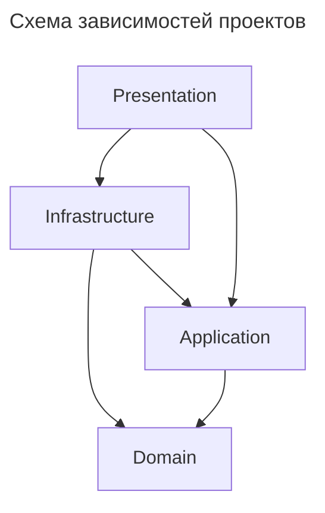
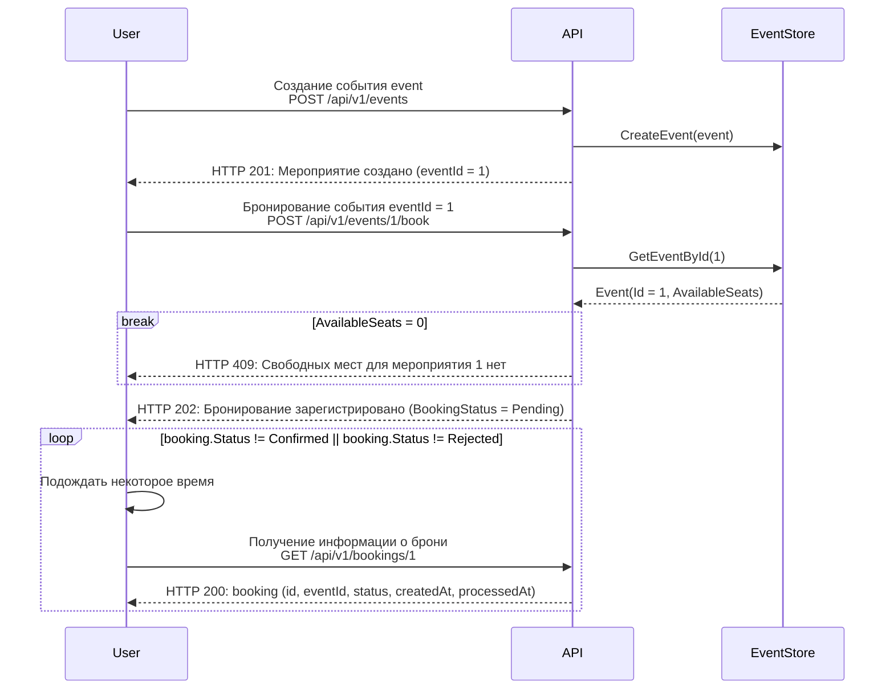

# EventManager API (API для управления мероприятиями)

## Структура проекта

EventManager API имеет микросервисную архитектуру и делится на несколько проектов:

1. EventManager.UserService - сервис пользователей.
2. EventManager.EventService - сервис мероприятий.
3. EventManager.BookingService - сервис бронирований.

Каждый проект состоит из нескольких слоев, следуя принципам чистой архитектуры:

1. Domain - слой домена, содержит бизнес-сущности, с которыми работает EventManager.
2. Application - слой приложения, содержит use cases, абстракции сервисов и репозиториев.
3. Infrastructure - слой инфраструктуры, содержит реализации абстракций, работает с внешними зависимостями (СУБД, кеширование и т.д.)
4. Presentation - слой представления, содержит описание API и предоставляет клиентам доступ к нему.



## Зависимости

API имеет внешние зависимости: 

- PostgreSQL (СУБД для хранения данных)
- Apache Kafka (распределенный журнал событий)
- Redis (кеширование)
- Prometheus (сбор метрик)
- Jaeger (сбор трейсов)

## Запуск API и зависимостей

Для удобного запуска API и внешних зависимостей подготовлен [docker-compose.yml](docker-compose.yml).

Запуск контейнеров производится с помощью команды:

```bash
docker compose up --build -d
```

После запуска Swagger будет доступен по адресам:
- EventManager.UserService - http://localhost:8081/swagger
- EventManager.EventService - http://localhost:8082/swagger
- EventManager.BookingService - http://localhost:8083/swagger

PostgreSQL для сервисов доступны по адресам:
- users-db - localhost:5432
- events-db - localhost:5433
- bookings-db - localhost:5434

Мониторинг сервисов:
- Prometheus - http://localhost:9090
- Jaeger - http://localhost:16686
- Grafana - http://localhost:3000

### Настройка подключения к PostgreSQL

У каждого микросервиса есть своя база данных. СУБД для них указаны в [docker-compose.yml](docker-compose.yml).
Строки подключения к СУБД PostgreSQL задаются в виде переменных окружения.

Например, `ConnectionStrings__EventsDb: Host=events-db;Port=5432;Database=events;Username=postgres;Password=postgres`.

Если docker не используется для запуска, то нужно задать строку подключения в файле `appsettings.json`.

Пример:

```json
// src/EventManager.EventService.Presentation/appsettings.json
"ConnectionStrings": {
  "EventsDb": "Host=localhost;Port=5432;Database=eventapi;Username=postgres;Password=postgres"
}
```

Схема базы данных будет создана автоматически (с помощью миграций), если она не существует.

### Настройка секрета JWT-токена

Секрет JWT-токена настраивается в файле `appsettings.json` (свойство `UserJwtToken/Secret`).

Пример:
```json
  "UserJwtToken":{
    "Secret": "superstrongsecret",
    ...
  }
```

Также секрет можно задать в docker-compose.yml: `UserJwtToken__Secret: superstrongsecret`.

### Миграции

Для добавления новой миграции следует запустить команду (примеры для `EventManager.EventService`):

```bash
dotnet ef migrations add <название_миграции> -p src/EventManager.EventService/EventManager.EventService.Infrastructure/EventManager.EventService.Infrastructure.csproj -s src/EventManager.EventService/EventManager.EventService.Presentation/EventManager.EventService.Presentation.csproj -o Persistence/Migrations/
```

После выполнения команды в проекте в папке Migrations появится новый файл с кодом миграции, состоящий из времени создания миграции и названия.

Для применения миграций используется команда:

```bash
dotnet ef database update -p src/EventManager.EventService/EventManager.EventService.Infrastructure/EventManager.EventService.Infrastructure.csproj -s src/EventManager.EventService/EventManager.EventService.Presentation/EventManager.EventService.Presentation.csproj
```

Для отката миграций используется команда:

```bash
dotnet ef database update <название_миграции> -p src/EventManager.EventService/EventManager.EventService.Infrastructure/EventManager.EventService.Infrastructure.csproj -s src/EventManager.EventService/EventManager.EventService.Presentation/EventManager.EventService.Presentation.csproj
```

## Сборка

Для сборки требуется:

- .NET 10

```bash
dotnet build
```

Для публикации каждого сервиса:

```bash
dotnet publish ./src/EventManager.UserService/EventManager.UserService.Presentation/EventManager.UserService.Presentation.csproj -c Release -o publish_user_service
dotnet publish ./src/EventManager.EventService/EventManager.EventService.Presentation/EventManager.EventService.Presentation.csproj -c Release -o publish_event_service
dotnet publish ./src/EventManager.BookingService/EventManager.BookingService.Presentation/EventManager.BookingService.Presentation.csproj -c Release -o publish_booking_service
```

## Тестирование

Тестирование можно запустить с помощью команд:

```bash
dotnet test --solution EventManager.slnx
```

### Интеграционное тестирование

Интеграционные тесты проверяют работу приложения с реальной базой данных:
- Как происходит чтение, запись, обновление и удаление.
- Проверка схемы базы данных, связи, ограничения.

Для этого используется библиотека TestContainers, которая запускает контейнер с СУБД PostgreSQL.
Поэтому для запуска тестов в проектах `test/EventManager.EventService/EventManager.EventService.IntegrationTests` и `test/EventManager.BookingService/EventManager.BookingService.IntegrationTests` потребуется установленный Docker.

## Описание API

После запуска сервер доступен на адресах http://localhost:8081 (UserService), http://localhost:8082 (EventService), http://localhost:8083 (BookingService)

Доступные эндпоинты:

### Управление мероприятиями

#### `GET /api/v1/events`

Получение всех мероприятий

Запрос:

```
GET /api/v1/events
```

```bash
curl -X 'GET' \
  'http://localhost:8082/api/v1/Events?Title=Workshop&From=2026-01-01&To=2026-06-01&Page=1&PageSize=10' \
  -H 'accept: text/plain'
```

Параметры запроса:

- Title (опциональный) - фильтр по названию мероприятия (регистронезависимый, частичное совпадение)
- From (опциональный) - фильтр мероприятий, которые начинаются не раньше указанной даты (в формате RFC 3339)
- To (опциональный) - фильтр мероприятий, которые заканчиваются не позже указанной даты (в формате RFC 3339)
- Page (опциональный) - номер страницы результатов
- PageSize (опциональный) - размер страницы

Ответ:

- `HTTP 200` - страница мероприятий

```json
{
  "items": [
    {
      "id": 1,
      "title": "Tech Workshop 2026",
      "description": "Annual gathering of tech leaders discussing AI, cloud computing, and the future of software development.",
      "startAt": "2026-03-10T09:00:00",
      "endAt": "2026-03-12T18:00:00",
      "totalSeats": 3,
      "availableSeats": 3
    },
    {
      "id": 6,
      "title": "Photography Workshop",
      "description": "Hands-on workshop covering portrait, landscape, and street photography techniques.",
      "startAt": "2026-05-08T10:00:00",
      "endAt": "2026-05-08T16:00:00",
      "totalSeats": 30,
      "availableSeats": 25
    }
  ],
  "itemCount": 2,
  "currentPage": 1,
  "totalPages": 1,
  "totalItems": 2
}
```

#### `GET /api/v1/events/{id}`

Получение мероприятия по идентификатору

Запрос:

```
GET /api/v1/events/1
```

```bash
curl -X 'GET' \
  'http://localhost:8082/api/v1/Events/1' \
  -H 'accept: text/plain'
```

Ответы:

- `HTTP 200` - мероприятие

```json
{
  "id": 1,
  "title": "Rock Concert",
  "description": "Metallica in Moscow",
  "startAt": "2026-05-07T15:00:00Z",
  "endAt": "2026-05-07T17:00:00Z",
  "totalSeats": 2000,
  "availableSeats": 1523
}
```

- `HTTP 404` - Мероприятие не найдено

#### `POST /api/v1/events`

Создание мероприятия

Запрос:

```
POST /api/v1/events
```

```bash
curl -X 'POST' \
  'http://localhost:8082/api/v1/Events' \
  -H 'accept: */*' \
  -H 'Content-Type: application/json' \
  -d '{
  "title": "Rock Concert",
  "description": "Metallica in Moscow",
  "startAt": "2026-05-07T15:00:00.000Z",
  "endAt": "2026-05-07T17:00:00.000Z",
  "totalSeats": 2000
}'
```

Ответы:

- `HTTP 201` - Мероприятие создано

```json
{
  "id": 1,
  "title": "Rock Concert",
  "description": "Metallica in Moscow",
  "startAt": "2026-05-07T15:00:00Z",
  "endAt": "2026-05-07T17:00:00Z",
  "totalSeats": 2000,
  "availableSeats": 2000
}
```
- `HTTP 401` - Пользователь не аутентифицирован
- `HTTP 403` - Пользователь не имеет прав на выполнение операции

#### `PUT /api/v1/events/{id}`

Обновление информации о мероприятии

Запрос:

```
PUT /api/v1/events/1
```

```bash
curl -X 'PUT' \
  'http://localhost:8082/api/v1/Events/1' \
  -H 'accept: */*' \
  -H 'Content-Type: application/json' \
  -d '{
  "title": "Jazz Concert",
  "description": "Frank Sinatra in Moscow",
  "startAt": "2026-05-08T15:00:00.000Z",
  "endAt": "2026-05-08T17:00:00.000Z"
}'
```

Ответы:

- `HTTP 204` - Мероприятие обновлено
- `HTTP 401` - Пользователь не аутентифицирован
- `HTTP 403` - Пользователь не имеет прав на выполнение операции
- `HTTP 404` - Мероприятие не найдено

#### `DELETE /api/v1/events/{id}`

Удаление мероприятия

Запрос:

```
DELETE /api/v1/events/1
```

```bash
curl -X 'DELETE' \
  'http://localhost:8082/api/v1/Events/1' \
  -H 'accept: */*'
```

Ответы:

- `HTTP 204` - Мероприятие удалено
- `HTTP 401` - Пользователь не аутентифицирован
- `HTTP 403` - Пользователь не имеет прав на выполнение операции
- `HTTP 404` - Мероприятие не найдено

#### `GET /api/v1/events/top`

Получение топ-10 популярных мероприятий

Запрос:

```
GET /api/v1/events/top
```

```bash
curl -X 'GET' \
  'http://localhost:8082/api/v1/Events/top' \
  -H 'accept: */*'
```

Ответы:

- `HTTP 200` - список из 10 мероприятий, отсортированный по популярности

```json
[
  {
    "id": 5,
    "title": "Jazz Night",
    "description": "Live jazz performance at Blue Note Club in New York",
    "startAt": "2026-11-12T19:00:00Z",
    "endAt": "2026-11-12T22:00:00Z",
    "totalSeats": 300,
    "availableSeats": 15
  },
  {
    "id": 1,
    "title": "Rock Concert",
    "description": "Alternative rock concert at Madison Square Garden in New York",
    "startAt": "2026-11-15T18:00:00Z",
    "endAt": "2026-11-15T21:00:00Z",
    "totalSeats": 2000,
    "availableSeats": 200
  },
  {
    "id": 8,
    "title": "Comedy Show",
    "description": "Stand-up comedy night featuring emerging comedians in Chicago",
    "startAt": "2026-11-20T20:00:00Z",
    "endAt": "2026-11-20T22:00:00Z",
    "totalSeats": 400,
    "availableSeats": 60
  },
  {
    "id": 3,
    "title": "Tech Conference",
    "description": "Annual software development and cloud computing conference in Seattle",
    "startAt": "2026-12-03T09:00:00Z",
    "endAt": "2026-12-03T17:00:00Z",
    "totalSeats": 1500,
    "availableSeats": 300
  },
  {
    "id": 10,
    "title": "Classical Music Evening",
    "description": "Symphony orchestra performing works by Beethoven in Boston",
    "startAt": "2026-12-08T19:30:00Z",
    "endAt": "2026-12-08T21:30:00Z",
    "totalSeats": 800,
    "availableSeats": 200
  },
  {
    "id": 4,
    "title": "Football Match",
    "description": "Exhibition football match at a stadium in Dallas",
    "startAt": "2026-12-12T16:00:00Z",
    "endAt": "2026-12-12T18:00:00Z",
    "totalSeats": 10000,
    "availableSeats": 3500
  },
  {
    "id": 7,
    "title": "Food Festival",
    "description": "International street food festival in San Francisco",
    "startAt": "2026-12-18T11:00:00Z",
    "endAt": "2026-12-18T20:00:00Z",
    "totalSeats": 1200,
    "availableSeats": 540
  },
  {
    "id": 2,
    "title": "Art Exhibition",
    "description": "Contemporary art exhibition featuring local artists in Los Angeles",
    "startAt": "2027-01-10T10:00:00Z",
    "endAt": "2027-01-10T16:00:00Z",
    "totalSeats": 500,
    "availableSeats": 300
  },
  {
    "id": 9,
    "title": "Gaming Tournament",
    "description": "Regional esports championship featuring competitive gaming teams in Austin",
    "startAt": "2027-01-16T12:00:00Z",
    "endAt": "2027-01-16T19:00:00Z",
    "totalSeats": 2000,
    "availableSeats": 1500
  },
  {
    "id": 6,
    "title": "Theater Performance",
    "description": "Modern adaptation of Hamlet at a theater in Philadelphia",
    "startAt": "2027-01-22T18:30:00Z",
    "endAt": "2027-01-22T21:00:00Z",
    "totalSeats": 600,
    "availableSeats": 540
  }
]
```

### Управление бронированиями

#### POST /api/v1/events/{id}/book

Бронирование мероприятия

Запрос:

```
POST /api/v1/events/1/book
```

```bash
curl -X 'POST' \
  'http://localhost:8083/api/v1/Events/1/book' \
  -H 'accept: */*'
```

Ответы:

- `HTTP 202` - Бронь зарегистрирована
```json
{
  "id": 1,
  "eventId": 1,
  "status": "Pending",
  "createdAt": "2026-06-26T20:45:18.6447899Z",
  "processedAt": null
}
```
- `HTTP 404` - Мероприятие не найдено
- `HTTP 409` - Мест для бронирования нет или превышен лимит бронирований

#### GET /api/v1/bookings/{id}

Получение бронирования по идентификатору

Запрос:

```
GET /api/v1/bookings/1
```

```bash
curl -X 'GET' \
  'http://localhost:8083/api/v1/Bookings/1' \
  -H 'accept: */*'
```

Ответы:

- `HTTP 200` - Возвращается бронирование
```json
{
  "id": 2,
  "eventId": 2,
  "status": "Confirmed",
  "createdAt": "2026-06-25T22:56:10.7207025Z",
  "processedAt": "2026-06-25T22:56:16.8534174Z"
}
```
- `HTTP 401` - Пользователь не аутентифицирован
- `HTTP 403` - Пользователь не имеет прав на выполнение операции
- `HTTP 404` - Бронирование не найдено

#### DELETE /api/v1/bookings/{id}

Отмена бронирования

Запрос:

```
DELETE /api/v1/bookings/1
```

```bash
curl -X 'DELETE' \
  'http://localhost:8083/api/v1/Bookings/1' \
  -H 'accept: */*'
```

Ответы:

- `HTTP 204` - Бронь отменена
- `HTTP 401` - Пользователь не аутентифицирован
- `HTTP 403` - Пользователь не имеет прав на выполнение операции
- `HTTP 404` - Бронирование не найдено

### Идентификация пользователя

#### Регистрация пользователя в системе

```
POST /api/v1/auth/register
```

```bash
curl -X 'POST' \
  'http://localhost:8081/api/v1/auth/register' \
  -H 'accept: */*' \
  -H 'Content-Type: application/json' \
  -d '{
  "login": "user",
  "password": "1234",
  "userRole": "User"
}'
```

Ответы:

- `HTTP 204` - Пользователь зарегистрирован
- `HTTP 400` - Ошибка валидации

#### Вход пользователя в систему

```
POST /api/v1/auth/login
```

```bash
curl -X 'POST' \
  'http://localhost:8081/api/v1/auth/login' \
  -H 'accept: */*' \
  -H 'Content-Type: application/json' \
  -d '{
  "login": "user",
  "password": "1234"
}'
```

Ответы:

- `HTTP 200` - Успешный вход. Возвращается JWT-токен.
```
eyJhbGciOiJIUzI1NiIsInR5cCI6IkpXVCJ9.eyJhdWQiO...
```
- `HTTP 400` - Неверные учетные данные

### Ошибки

Ошибки возвращаются в формате ProblemDetails (RFC 7807):

```json
{
  "title": "An error occurred",
  "status": 500,
  "detail": "Fail"
}
```

## Работа с пользователями

В EventManager API некоторые запросы требуют аутентификации и авторизации.
Для регистрации в системе пользователь может воспользоваться запросом `POST /api/v1/auth/register`, а для входа `POST /api/v1/auth/login`.
Для регистрации администратора нужно указать `"userRole": "Admin"` в теле запроса на регистрацию.
При успешной регистрации пользователь получает JWT-токен, который следует передавать в заголовке `Authorization`:
```
Bearer <JWT-токен>
```

Пользователи могут относиться к следующим ролям:
- User - обычный пользователь
- Admin - администратор

Отличие администратора от пользователя в том, что первому доступны запросы для добавления, изменения или удаления мероприятий, а также управление любыми бронированиями.

## Бронирование мероприятий

Обработка бронирований на мероприятия осуществляется в фоновом режиме сервисом EventManager.BookingService (фоновая задача `BookingConfirmationBackgroundService`).
При старте он подключается к экземпляру Kafka, периодически опрашивает БД на наличие новых бронирований, и обрабатывает их.
Далее сервис присваивает брони статус "Confirmed", сохраняет её в БД и отправляет событие в Kafka (топик `booking-confirmed`), содержащее всю необходимую информацию.
В случае отмены пользователем бронирования сервис отправляет событие в топик `booking-cancelled`.

Сервис EventManager.EventService имеет фоновые задачи:
- `BookingConfirmationEventConsumer` - подписывается на топик `booking-confirmed` (при получении события резервирует места).
- `BookingCancelledEventConsumer` - подписывается на топик `booking-cancelled` (при получении события освобождает места).

`BookingConfirmationEventConsumer` при получении события в топике `booking-confirmed` и отсутствия мест отправляет событие `booking-rejected` обратно сервису BookingService.

## Кеширование данных

В сервисе EventService реализовано кеширование с помощью Redis с использованием паттерна Cache-Aside для следующих данных:

1. GET /events/{id} - кеширование мероприятий получаемых по идентификатору (TTL = 5 минут)

В следующих случаях значение кеша для мероприятия обновляется (Update-on-Write):
- При изменении мероприятия.
- При отмене бронирования (из обработчика Kafka).
- При подтверждении бронирования (из обработчика Kafka).

Обновление записи (а не инвалидация) обусловлено тем, что в результате выполнения операций в памяти есть уже свежий объект мероприятия, который можно записать в кеш, не выполняя новый запрос в БД.

В следующих случаях значение кеша для мероприятия удаляется:
- При удалении мероприятия.

TTL в 5 минут выбран, потому что данные о наличии свободных мест могут меняться в течении нескольких минут, а основные данные о мероприятии (название, описание, общее количество мест, дата начала и конца) меняются достаточно редко.
Цена ошибки для бизнеса невелика.

Изменения пишутся сначала в БД, а потом обновляются в кеше. Обусловлено тем, что race condition маловероятен, а если он произойдет, то маленький TTL от длительного расхождения.

2. GET /events/top - кеширование списка топ-10 популярных мероприятий (TTL = 1 час)

TTL в 1 час выбран потому что это статистические данные, а запрос на получение таких данных достаточно дорогая операция (если данных много).
Инвалидация таких данных при каждом изменении мест не нужна, так как вероятность того, что при +-1 месте поменяется топ, очень мала, и цена ошибки также мала.

При недоступности Redis API продолжает стабильно работать, все неудачные попытки обращения к Redis логируются, а запросы будут идти напрямую к БД.

## Наблюдаемость (Observability)

В сервисы интегрирован OpenTelemetry SDK для стандартизированного сбора метрик, трейсов и логов.

Вся телеметрия отправляется в Prometheus (метрики) и Jaeger (трейсы). Также docker-compose поднимает контейнер с Grafana, который позволяет визуализировать значения метрик в виде графиков.

В главном dashboard Grafana можно увидеть:
- Latency (p50, p95, p99)
- Error rate
- Throughput (RPS)
- Количество активных запросов

Данные суммированны по всем трем сервисам. Экспортированный дашборд можно найти в файле `grafana-dashboard.json`.

## Сценарии использования

### Сценарий: создание события, бронирование, проверка статуса брони, отсутствие мест


